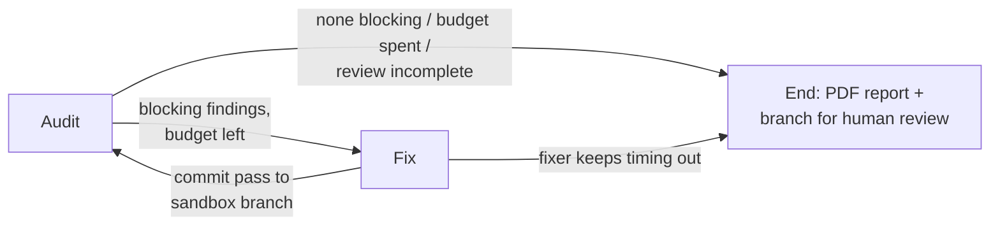

# ZweiGeeks

[](https://github.com/Namidok/ZweiGeeks/actions/workflows/ci.yml)

Two agents, one loop. The **Auditor** finds what's broken in a repository
(security, code quality, API and UI hygiene, failing tests); the **Fixer**
proposes targeted edits for the blocking findings; the Auditor re-checks the
result. The loop runs on a throwaway git branch until nothing blocking is
left, the iteration budget runs out, or the local LLM stops responding, and
a human reviews the branch before anything is merged.

Everything runs locally against an [Ollama](https://ollama.com) server: no
API keys, and no code leaves the machine.

## How it works



The loop is a [LangGraph](https://github.com/langchain-ai/langgraph) state
graph (`src/graph.py`). All stop/continue decisions are made in the audit
node, and routing functions only read the result.

### Auditor (`src/agents/auditor.py`)

Runs in order of how much each source can be trusted:

1. **Deterministic repo hygiene** (`src/tools/repo_hygiene.py`), no LLM:
   secret-looking files tracked by git (and whether `.gitignore` *also*
   matches them, meaning they were committed before the rule or force-added),
   stray backup files, debug/test PHP scripts left in a deployable tree, and
   `require`/`include` targets that don't exist (grouped by missing target).
2. **Static tools**, only when `src/tools/stack_detect.py` finds a Python
   stack: `bandit`, `pip-audit` (reads `requirements.txt`), `ruff`, the
   repo's own `pytest` suite, and a heuristic scan for mutating API routes
   without validation/auth. Every tool and the LLM review only see the
   project's own files, as listed by git (tracked, plus untracked files
   that aren't ignored), so a `venv/` or other ignored folder inside the
   repo is never scanned. Tests run with the repo's own virtualenv
   (`venv/`, `.venv/` or `env/`) when it has one; if that environment has
   no pytest, the suite is reported as skipped rather than failing.
   Tool output is mapped straight into findings,
   with no LLM in between to paraphrase or drop results. A static scan of
   HTML/PHP templates (missing `alt`, missing viewport meta, heavy inline
   styles) runs for every stack.
3. **Per-file LLM review**: reads up to `AUDIT_MAX_FILES` real source files
   (security-sounding names such as `auth`, `login`, `config` first) and asks
   the model for findings as a JSON array. Unparseable replies are counted as
   "not reviewed", never as "clean".
4. **Improvements**: one summarising call for broader suggestions in the
   report.

A finding is **blocking** if it is open, `critical`/`high`, and not from the
repo-hygiene check. Leaked credentials and missing shared files need a human
(rotate the key, restore the file), so they are reported but never sent to
the Fixer.

### Fixer (`src/agents/fixer.py`)

One blocking finding at a time:

- The model sees the file with line numbers (or a window around the
  finding's line if the file exceeds `FIXER_MAX_FILE_CHARS`) and must answer
  with `SEARCH/REPLACE` edit blocks, not a rewritten file, so every line
  outside a block is preserved byte-for-byte. Edits that don't apply get one
  retry with the reason fed back.
- Before anything touches disk, the edit must pass deterministic gates:
  reply not cut off at the token cap, file actually changed, no new PHP
  syntax errors (`php -l`, or tree-sitter if PHP isn't installed), for
  secret-exposure findings the leaking output really removed, no deleted
  code that fills a variable still in use, no deleted placeholder-credential
  check, and no calls to PHP functions that exist nowhere in the repo.
  For Python files: the edit must still parse, must not delete an existing
  function or class, and must not use names that are defined nowhere in the
  file (ruff's F821 - e.g. `sql.escape(...)` with no `sql` imported).
- Then a second LLM call acts as **verifier**: given the diff, does it
  resolve the issue and preserve existing behaviour? Only then is the file
  written.
- After writing a Python fix, the edited module is imported with the
  project's own interpreter. If it imported before the edit and doesn't
  after (say the edit raises at import time when an environment variable
  is missing), the file is rolled back and the fix rejected. Set
  `FIXER_IMPORT_CHECK=0` to skip this.

Each fix pass commits only the files the Fixer edited to the sandbox
branch, never stray files from the working tree, and the next audit pass
re-verifies the result.

### Human in the loop

ZweiGeeks creates `zweigeeks/<unix-timestamp>` off your current branch,
refuses to start on a dirty working tree, never pushes, never merges, and
switches the repo back to your original branch when the run ends (also on
errors or Ctrl+C). The fixes stay on the sandbox branch for you to review:

```bash
git diff main..zweigeeks/1737558000
```

### Reliability: a local LLM that hangs

A local Ollama runner can wedge (`ollama ps` shows the model stuck on
"Stopping...") so that a request never returns and never raises. ZweiGeeks
handles this explicitly:

- Every model call goes through `src/ollama_client.chat()`, which runs it on
  a daemon thread with a hard wall-clock timeout and raises `OllamaTimeout`.
- On a timeout, if the host is local and `ollama ps` confirms a wedge, it
  kills the process listening on the Ollama port (the Ollama app/launchd
  restarts it), waits a few seconds and retries once.
- Circuit breakers in both the per-file review and the fix pass stop after
  `OLLAMA_MAX_CONSECUTIVE_TIMEOUTS` failures in a row instead of grinding
  through every remaining file at the full timeout each.
- An aborted review sets `audit_incomplete`. The run then ends with
  `stop_reason` `ollama_wedged_incomplete` (or `ollama_error_incomplete` /
  `no_files_reviewed_incomplete`), **never** as clean, and the PDF gets a
  warning banner saying the absence of findings is not evidence of clean
  code.
- A fixed sampling seed makes output repeatable for identical input, and
  per-call token caps stop repetition loops from tying up the server.

## Setup

Requires Python 3.11+ (CI runs 3.11), git, and a local Ollama install.

```bash
ollama pull qwen2.5-coder:7b
ollama serve                      # if the Ollama app isn't already running

python3 -m venv .venv
source .venv/bin/activate
pip install -r requirements.txt
```

Configuration is read from environment variables (or a `.env` file).
Defaults:

| Variable | Default | Purpose |
|---|---|---|
| `OLLAMA_HOST` | `http://localhost:11434` | Ollama server |
| `AUDITOR_MODEL` | `qwen2.5-coder:7b` | File review, improvements, fix verifier |
| `FIXER_MODEL` | `qwen2.5-coder:7b` | Edit generation |
| `MAX_ITERATIONS` | `5` | Default audit passes per job (API) |
| `OLLAMA_NUM_CTX` | `8192` | Context window requested from Ollama |
| `AUDIT_MAX_FILES` | `30` | Files the LLM reviews per audit pass |
| `AUDIT_MAX_FILE_CHARS` | `12000` | Characters of each file shown to the reviewer |
| `FIXER_MAX_FILE_CHARS` | `12000` | Above this, the Fixer sees a window around the finding |
| `OLLAMA_TIMEOUT_SECONDS` | `120` | Hard cap per model call |
| `FIXER_TIMEOUT_SECONDS` | `300` | Hard cap per Fixer call |
| `OLLAMA_MAX_CONSECUTIVE_TIMEOUTS` | `3` | Circuit-breaker threshold |
| `OLLAMA_AUTO_RESTART_ON_TIMEOUT` | `1` | Set `0` to never kill the Ollama process |
| `OLLAMA_SEED` | `42` | Fixed sampling seed |
| `OLLAMA_TEMPERATURE` | unset | Optional override (avoid `0`, which loops) |
| `OLLAMA_NUM_PREDICT` | `1024` | Max tokens per call |
| `FIXER_NUM_PREDICT` | `2048` | Max tokens per Fixer call |
| `REPORTS_DIR` | `audit_results` | Where PDF reports are written |

## Run it

The target must be a local git repo with a branch checked out and no
uncommitted changes to tracked files.

**From Python:**

```python
from src.graph import run_audit_only, run_pipeline

# Read-only: findings + PDF report, no branch, no edits.
run_audit_only("/path/to/repo")

# Full audit -> fix -> re-audit loop on a sandbox branch.
state = run_pipeline("/path/to/repo", max_iterations=3)
print(state["stop_reason"], state["branch_name"], state["pdf_path"])
```

**In the browser:** run `python run.py` and open <http://127.0.0.1:8008>.
(Auto-reload is off, because restarting the server kills a run in progress;
set `ZWEIGEEKS_RELOAD=1` when working on ZweiGeeks itself.)
Enter a repo path, pick **Audit and fix** or **Audit only**, and start the
run. The two agents act it out in a small pixel-art office: the Auditor
works at its desk and carries blocking findings to the hand-off table, the
Fixer picks them up and works through them at its bench, commits at the git
rack, and the PDF comes out of the printer. Next to the office, an activity
log shows every step as text. When the run ends, a report opens with the
findings by severity, every fix attempt and why it was or wasn't applied,
the diff on the sandbox branch, and a PDF download. Reloading the page picks
the current run back up.

**Fix passes** is how many times the Fixer gets a turn; every fix pass is
followed by an audit, and the last audit checks the last fixes. So 1 means
audit, fix, re-audit.

When a run that changed files ends, the fixes are put into your working copy
(the "Put the fixes in my working copy" option, on by default): ZweiGeeks
checks out a new `zweigeeks/<id>-review` branch off your branch with the
fixes applied as **uncommitted** changes, so VS Code's Source Control view
lists every changed file with a side-by-side diff. Commit them there to keep
them, or discard them and switch back to your branch. With the option off,
the **Show fixes in my editor** button does the same later. A run refuses to
start while the repo is still on a `zweigeeks/<id>` sandbox branch left by
a run that didn't finish.

The UI is plain HTML, CSS and JavaScript in `static/`, with no build step
and nothing loaded from the network. The office (`static/office.js`) is
drawn with canvas calls; there are no sprite files.

**As a local service** (FastAPI on `127.0.0.1:8008`):

```bash
python run.py

curl -s -X POST http://127.0.0.1:8008/api/jobs \
  -H 'Content-Type: application/json' \
  -d '{"repo_path": "/path/to/repo", "max_iterations": 3, "mode": "fix"}'
# -> {"job_id": "..."}   mode: "fix" (default) or "audit" (read-only)

curl -s http://127.0.0.1:8008/api/jobs/<job_id>          # status + result
curl -s -O http://127.0.0.1:8008/api/jobs/<job_id>/report # the PDF
```

Progress events (tool runs, per-file reviews, fix attempts, commits) stream
as JSON over the websocket at `ws://127.0.0.1:8008/ws/<job_id>`. A client
that connects late gets every earlier event replayed first.

The PDF report lands in `REPORTS_DIR` (relative to where ZweiGeeks runs, so
it stays out of the audited repo), grouped into high/medium/low with a
suggested resolution per finding.

## Tests

```bash
pytest -q
```

The suite needs no Ollama server: every model call is mocked, and a fixture
makes any unmocked call fail loudly. It covers the repo-hygiene checks
against throwaway git repos, LLM-output parsing, the timeout/restart logic,
both circuit breakers, every stop reason in the graph, the Fixer's edit
application and rejection gates, PDF generation, and the job API the UI
uses (both modes, the report download, websocket replay). CI runs `ruff` and the
suite with coverage on every push and pull request.

## Known limitations

- **No way to cancel a run from the UI.** Stopping the server mid-run kills
  the job thread before it can switch the repo back, so you may need to
  `git checkout` your own branch afterwards.
- **The UI has no automated tests.** The API it calls is covered by
  `tests/test_server.py`; the page itself was checked by hand in Chrome.
- **Language coverage is uneven.** Python repos get the full static tool
  set. PHP repos get repo-hygiene checks, the LLM review and PHP-specific
  Fixer gates. Other languages get the LLM review and template heuristics
  only. The Python import check only proves a module still imports; when
  the repo's environment has pytest, the next audit pass also re-runs its
  tests.
- **Heuristic checks are heuristics.** API checks grep route decorators, and
  UI checks are a few regexes, not a live fuzz test or a Lighthouse run.
- **A 7B local model is a weak reviewer.** Findings can be wrong or vary
  between models, line numbers are approximate, and the verifier can be
  fooled. That's why the deterministic gates exist and why a human reviews
  the branch.
- **No benchmark results yet.** There is no measured precision/recall or
  fix-rate evaluation in this repo.
- **The service is a local tool.** Jobs live in memory and there is no
  authentication; it binds to `127.0.0.1` and shouldn't be exposed.
- **Auto-restart uses `lsof` and `kill -9`** (macOS/Linux) and only acts on
  a local `OLLAMA_HOST`. Disable it with `OLLAMA_AUTO_RESTART_ON_TIMEOUT=0`.

## Project layout

```
src/
  graph.py            LangGraph audit -> fix loop, sandbox branch handling
  agents/auditor.py   deterministic checks + static tools + per-file LLM review
  agents/fixer.py     edit-block fixes, deterministic gates, LLM verifier
  ollama_client.py    timeout-safe model calls, wedge detection, restart
  tools/              repo hygiene, stack detection, bandit/pip-audit, ruff/pytest, API/UI heuristics
  report.py           PDF report
  server.py           FastAPI + websocket job API, serves the web UI
  schemas.py          Finding, AuditReport, FixAttempt
  config.py           environment-driven settings
static/
  index.html          the web UI
  app.js              job form, activity log, report dialog
  office.js           pixel-art office scene (canvas, no assets)
  style.css
tests/                pytest suite (no LLM required)
```
