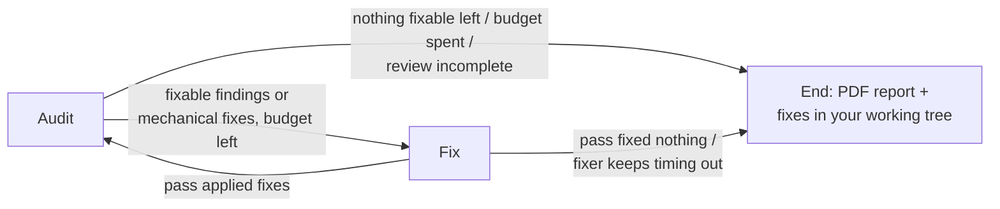

# ZweiGeeks

[](https://github.com/Namidok/ZweiGeeks/actions/workflows/ci.yml)

Two agents, one loop. **KAI**, the Auditor, finds what's broken in a
repository (security, code quality, API and UI hygiene, failing tests);
**JAX**, the Fixer, makes targeted edits for the findings, most severe
first; KAI re-checks the result. The loop runs until nothing JAX can act on
is left, it stops making progress, the iteration budget
runs out, or the local LLM stops responding. The fixes then land in your
working tree as ordinary **uncommitted changes**, so you review them in your
editor's Source Control view before committing anything.

Everything runs locally against an [Ollama](https://ollama.com) server: no
API keys, and no code leaves the machine.

## How it works



The loop is a [LangGraph](https://github.com/langchain-ai/langgraph) state
graph (`src/graph.py`). All stop/continue decisions are made in the audit
node, and routing functions only read the result.

### Auditor (`src/agents/auditor.py`)

Runs in order of how much each source can be trusted:

1. **Deterministic repo hygiene** (`src/tools/repo_hygiene.py`), no LLM:
   secret-looking files tracked by git (and whether `.gitignore` *also*
   matches them, meaning they were committed before the rule or force-added),
   stray backup files, debug/test PHP scripts left in a deployable tree, and
   `require`/`include` targets that don't exist (grouped by missing target).
2. **Static tools**, only when `src/tools/stack_detect.py` finds a Python
   stack: `bandit`, `pip-audit` (reads `requirements.txt`), `ruff`, the
   repo's own `pytest` suite, and a heuristic scan for mutating API routes
   without validation/auth. Every tool and the LLM review only see the
   project's own files, as listed by git (tracked, plus untracked files
   that aren't ignored), so a `venv/` or other ignored folder inside the
   repo is never scanned. Tests run with the repo's own virtualenv
   (`venv/`, `.venv/` or `env/`) when it has one; if that environment has
   no pytest, the suite is reported as skipped rather than failing.
   Tool output is mapped straight into findings,
   with no LLM in between to paraphrase or drop results. A static scan of
   HTML/PHP templates (missing `alt`, missing viewport meta, heavy inline
   styles) runs for every stack.
3. **Per-file LLM review**: reads up to `AUDIT_MAX_FILES` real source files
   (security-sounding names such as `auth`, `login`, `config` first) and asks
   the model for findings as a JSON array. Unparseable replies are counted as
   "not reviewed", never as "clean".
4. **Improvements**: one summarising call for broader suggestions in the
   report.

Every finding gets a **fingerprint**: a hash of the tool, the file, the rule
(or, for LLM findings, the normalised title) and the text of the flagged
line - not its line number or its per-run id, which change between audits.
The loop uses it to recognise "the same issue again".

A finding **can keep the loop going** only if the Fixer can act on it: it has
a file, it isn't from the repo-hygiene check (a leaked key needs rotating, a
missing file restoring), it isn't a suite-level pytest failure, it isn't a
pip-audit advisory (the deterministic fixer handles those), and the Fixer
hasn't given up on it. Everything else is reported but never blocks. Fixable
findings are worked most severe first (security before quality at equal
severity) down to `FIXER_MIN_SEVERITY`, at most `FIXER_MAX_FIXES_PER_PASS` per
pass.

The per-file LLM review is cached by (file path, content hash, model, review
prompt), so a re-audit only re-reviews files the Fixer edited, and unchanged
files can't produce "new" findings. The summarising "improvements" call runs
once per run.

### Deterministic fixes (`src/agents/deterministic.py`)

Run first in every fix pass, with no model involved:

- **ruff**: `ruff check --fix` on the files that have ruff findings, applying
  only the fixes ruff itself marks safe, with the project's own ruff config.
- **Vulnerable dependencies**: in `requirements.txt`, `package==old` (or the
  minimum in `package>=old` / `~=old`) is raised to the lowest version that
  fixes every pip-audit advisory for that package; a vulnerable
  sub-dependency that isn't listed gets a `package>=fixed` line added.
  Nothing is installed; the next audit re-checks it.

They're counted separately in the run summary.

### Fixer (`src/agents/fixer.py`)

One finding at a time, most severe first:

- The model sees the file with line numbers (or a window around the
  finding's line if the file exceeds `FIXER_MAX_FILE_CHARS`) and must answer
  with `SEARCH/REPLACE` edit blocks, not a rewritten file, so every line
  outside a block is preserved byte-for-byte. A SEARCH is matched exactly,
  then ignoring surrounding whitespace, then ignoring runs of whitespace
  inside lines; if it still matches several places, the one nearest the
  finding's line is edited. Edits that don't apply get one retry with the
  reason fed back. After an applied edit, the other findings in that file are
  re-located by their flagged line text.
- Before anything touches disk, the edit must pass deterministic gates:
  reply not cut off at the token cap, file actually changed, no new PHP
  syntax errors (`php -l`, or tree-sitter if PHP isn't installed), for
  secret-exposure findings the leaking output really removed, no deleted
  code that fills a variable still in use, no deleted placeholder-credential
  check, and no calls to PHP functions that exist nowhere in the repo.
  For Python files: the edit must still parse, must not delete an existing
  function or class, and must not use names that are defined nowhere in the
  file (ruff's F821 - e.g. `sql.escape(...)` with no `sql` imported).
- Then a second LLM call acts as **verifier**: given the diff, does it
  resolve the issue and preserve existing behaviour? Only then is the file
  written.
- After writing a Python fix, the edited module is imported with the
  project's own interpreter. If it imported before the edit and doesn't
  after (say the edit raises at import time when an environment variable
  is missing), the file is rolled back and the fix rejected. Set
  `FIXER_IMPORT_CHECK=0` to skip this.

### Convergence

The loop remembers what it tried, per fingerprint:

- A rejected fix is **retried right away** with the rejection reason added to
  the prompt ("Your previous edit was rejected because ...") and a different
  seed (`OLLAMA_SEED` + attempt number, Fixer calls only; audits keep the
  fixed seed so they stay repeatable) - never as an identical request.
- After `FIXER_MAX_ATTEMPTS_PER_FINDING` attempts (default 3) the finding is
  marked **needs manual fix**. Timeouts and rejections that come from the
  file itself (missing, too large to window) aren't retried.
- A fix pass that applies **nothing** ends the run with `stop_reason`
  `no_progress`; it doesn't audit an unchanged repo again. If only exhausted
  findings are left, the run ends with `needs_manual_fix`.

### Human in the loop

Fixes are edited **straight into your working tree**, the way any editor
would, and left uncommitted. ZweiGeeks never creates a branch, stages,
commits, stashes or pushes. Open VS Code's Source Control view: every file it
changed is under **Changes** with a side-by-side diff. Keep what you like by
committing it; discard the rest from the same view.

Files you've already changed yourself are edited too, on top of your
changes, like any editor would. The run summary and
`audit_results/<run>/fixes.patch` list only ZweiGeeks' own edits (for those
files, the diff is against your version, not against HEAD). Set
`ZWEIGEEKS_PROTECT_DIRTY=1` to have such files skipped instead. If a run is
interrupted, whatever was fixed so far stays in your files.

Prefer not to have your files edited during a run? Set `ZWEIGEEKS_ISOLATE=1`:
the run then audits and fixes in a private detached git worktree of HEAD,
and applies the result to your working tree at the end with `git apply`, file
by file, skipping files you've changed or that no longer match (patch in
`skipped.patch`). The worktree is removed even on errors and Ctrl+C, and
leftovers from crashed runs are pruned on the next start. In that mode the
audit sees your last commit, not uncommitted edits.

### Reliability: a local LLM that hangs

A local Ollama runner can wedge (`ollama ps` shows the model stuck on
"Stopping...") so that a request never returns and never raises. ZweiGeeks
handles this explicitly:

- Every model call goes through `src/ollama_client.chat()`, which runs it on
  a daemon thread with a hard wall-clock timeout and raises `OllamaTimeout`.
- On a timeout, if the host is local and `ollama ps` confirms a wedge, it
  kills the process listening on the Ollama port (the Ollama app/launchd
  restarts it), waits a few seconds and retries once.
- Circuit breakers in both the per-file review and the fix pass stop after
  `OLLAMA_MAX_CONSECUTIVE_TIMEOUTS` failures in a row instead of grinding
  through every remaining file at the full timeout each.
- An aborted review sets `audit_incomplete`. The run then ends with
  `stop_reason` `ollama_wedged_incomplete` (or `ollama_error_incomplete` /
  `no_files_reviewed_incomplete`), **never** as clean, and the PDF gets a
  warning banner saying the absence of findings is not evidence of clean
  code.
- A fixed sampling seed makes output repeatable for identical input, and
  per-call token caps stop repetition loops from tying up the server.

## Setup

Requires Python 3.11+ (CI runs 3.11), git, and a local Ollama install.

```bash
ollama pull qwen2.5-coder:7b
ollama serve                      # if the Ollama app isn't already running

python3 -m venv .venv
source .venv/bin/activate
pip install -r requirements.txt
```

Configuration is read from environment variables (or a `.env` file).
Defaults:

| Variable | Default | Purpose |
|---|---|---|
| `OLLAMA_HOST` | `http://localhost:11434` | Ollama server |
| `AUDITOR_MODEL` | `qwen2.5-coder:7b` | File review and improvements |
| `FIXER_MODEL` | `qwen2.5-coder:7b` | Edit generation |
| `VERIFIER_MODEL` | same as `AUDITOR_MODEL` | Approves or rejects each proposed fix |
| `MAX_ITERATIONS` | `5` | Default fix passes per job |
| `FIXER_MIN_SEVERITY` | `low` | Lowest severity sent to the LLM Fixer (`critical`, `high`, `medium`, `low`, `info`) |
| `FIXER_MAX_FIXES_PER_PASS` | `15` | Findings the LLM Fixer attempts per pass, most severe first |
| `FIXER_MAX_ATTEMPTS_PER_FINDING` | `3` | Attempts before a finding is marked needs manual fix |
| `FIXER_IMPORT_CHECK` | `1` | Import the edited Python module after a fix; `0` to skip |
| `REVIEW_CACHE` | `1` | Cache per-file LLM reviews by content; `0` to always ask the model |
| `ZWEIGEEKS_ISOLATE` | `0` | `1` = work in a private git worktree and apply the result at the end |
| `ZWEIGEEKS_PROTECT_DIRTY` | `0` | `1` = never edit files you have uncommitted changes in |
| `REVIEW_CACHE_DIR` | `<REPORTS_DIR>/.review_cache` | Where cached reviews live |
| `OLLAMA_NUM_CTX` | `8192` | Context window requested from Ollama |
| `AUDIT_MAX_FILES` | `30` | Files the LLM reviews per audit pass |
| `AUDIT_MAX_FILE_CHARS` | `12000` | Characters of each file shown to the reviewer |
| `FIXER_MAX_FILE_CHARS` | `12000` | Above this, the Fixer sees a window around the finding |
| `OLLAMA_TIMEOUT_SECONDS` | `120` | Hard cap per model call |
| `FIXER_TIMEOUT_SECONDS` | `300` | Hard cap per Fixer call |
| `OLLAMA_MAX_CONSECUTIVE_TIMEOUTS` | `3` | Circuit-breaker threshold |
| `OLLAMA_AUTO_RESTART_ON_TIMEOUT` | `1` | Set `0` to never kill the Ollama process |
| `OLLAMA_SEED` | `42` | Fixed sampling seed |
| `OLLAMA_TEMPERATURE` | unset | Optional override (avoid `0`, which loops) |
| `OLLAMA_NUM_PREDICT` | `1024` | Max tokens per call |
| `FIXER_NUM_PREDICT` | `2048` | Max tokens per Fixer call |
| `REPORTS_DIR` | `audit_results` | PDF reports and per-run folders (`run.jsonl`, patches) |

## Run it

The target must be a local git repo with at least one commit. Uncommitted
changes of your own are fine: files you've changed are never overwritten.

**From Python:**

```python
from src.graph import run_audit_only, run_pipeline

# Read-only: findings + PDF report, no edits.
run_audit_only("/path/to/repo")

# Audit -> fix -> re-audit; the fixes land in the working tree, unstaged.
state = run_pipeline("/path/to/repo", max_iterations=3)
print(state["stop_reason"], state["applied_files"], state["skipped_files"])
```

Or from the command line, which prints the run summary:

```bash
python -m src.cli /path/to/repo --passes 3     # audit + fix
python -m src.cli /path/to/repo --audit-only
```

**The run log.** Every run writes `audit_results/<run_id>/run.jsonl`: each
audit's findings by source, and for every fix attempt the finding's
fingerprint, source tool, file, pass, the full prompt, the model's raw reply,
the rejection reason and notes, the seed and how long it took. At the end a
summary table is printed (and sent to the UI as a `run_summary` event):
findings by source, fixes applied (LLM and deterministic), rejections by
reason, model calls and seconds by role, files changed in your working tree
and files skipped. When fixes don't land, read the rejections table first.

**In the browser:** run `python run.py` and open <http://127.0.0.1:8008>.
(Auto-reload is off, because restarting the server kills a run in progress;
set `ZWEIGEEKS_RELOAD=1` when working on ZweiGeeks itself.)
Enter a repo path, pick **Audit and fix** or **Audit only**, and start the
run. The two agents act it out in a small pixel-art office: KAI works at
its desk and carries findings to the hand-off table, JAX picks them up and
works through them at its bench, the rack blinks
after each fix pass, and the PDF comes out of the printer. Next to the office, an activity
log shows every step as text. When the run ends, a report opens with the
findings by severity, every fix attempt and why it was or wasn't applied,
the diff of what changed, and a PDF download. The outcome card says how many
files changed in your working tree and lists any skipped. Reloading the page
picks the current run back up.

**Fix passes** is how many times the Fixer gets a turn; every fix pass is
followed by an audit, and the last audit checks the last fixes. So 1 means
audit, fix, re-audit.

The UI is plain HTML, CSS and JavaScript in `static/`, with no build step
and nothing loaded from the network. The office (`static/office.js`) is
drawn with canvas calls; there are no sprite files.

**As a local service** (FastAPI on `127.0.0.1:8008`):

```bash
python run.py

curl -s -X POST http://127.0.0.1:8008/api/jobs \
  -H 'Content-Type: application/json' \
  -d '{"repo_path": "/path/to/repo", "max_iterations": 3, "mode": "fix"}'
# -> {"job_id": "..."}   mode: "fix" (default) or "audit" (read-only)

curl -s http://127.0.0.1:8008/api/jobs/<job_id>          # status + result
curl -s -O http://127.0.0.1:8008/api/jobs/<job_id>/report # the PDF
```

Progress events (tool runs, per-file reviews, fix attempts, fix passes) stream
as JSON over the websocket at `ws://127.0.0.1:8008/ws/<job_id>`. A client
that connects late gets every earlier event replayed first.

The PDF report lands in `REPORTS_DIR` (relative to where ZweiGeeks runs, so
it stays out of the audited repo), grouped into high/medium/low with a
suggested resolution per finding.

## Measured results

One benchmark so far, on the planted-issue fixture in `tests/fixtures/vuln_py`
(2 Python files, 2 pinned dependencies): `qwen2.5-coder:7b` for every role,
5 fix passes allowed, an M-series Mac with 16 GB, one run each. Treat it as an
illustration of the loop, not a statistically meaningful evaluation.

| | Before (sandbox-branch loop) | After (this loop) |
|---|---|---|
| Stop reason | `max_iterations_reached` | `no_progress` |
| Audits / fix passes | 6 / 5 | 2 / 2 |
| Fix attempts | 115 | 31 |
| Fixes applied | 4 (LLM) | 5 (LLM) + 10 (deterministic) |
| pip-audit findings, first -> last audit | 21 -> 21 | 21 -> 0 |
| ruff findings, first -> last audit | 4 -> 4 | 4 -> 1 |
| Rejections | `no_file` 105, `undefined_name` 5, `not_verified` 1 | `undefined_name` 5, `no_change` 5, `edit_mismatch` 3, `not_verified` 2, `python_syntax_error` 1 |
| Needs manual fix | n/a | 2 |
| Model calls (auditor / fixer / verifier) | 18 / 10 / 5 = 33 | 5 / 25 / 7 = 37 |
| Model time | 237 s | 281 s |
| Wall time | 264 s | 295 s |

What the numbers say: the 105 `no_file` attempts (file-less pip-audit
advisories retried every pass) are gone, the 21 advisories are fixed by two
pin bumps with no model call, and the loop stops when a pass can't fix
anything instead of auditing an unchanged repo. What they don't say: the
model is no better at fixing code. Only 5 of its 25 fixer calls produced an
accepted edit, and 22 of the 26 LLM attempts that were rejected were
`undefined_name` (a fix using `os` without importing it), `no_change` or
`edit_mismatch`. Total time went up slightly because the Fixer now makes
real retries instead of skipping work. The next lever is the model.

### Trying a larger coder model

Roles are configured separately, so a stronger model can be tried where it
matters without changing the default:

```bash
ollama pull qwen2.5-coder:14b          # needs roughly 10 GB free; check `ollama ps`
FIXER_MODEL=qwen2.5-coder:14b python -m src.cli /path/to/repo --passes 3
# a different verifier makes the approval independent of the author:
FIXER_MODEL=qwen2.5-coder:14b VERIFIER_MODEL=qwen3:8b python -m src.cli ...
```

Compare the printed summaries (applied fixes, rejections by reason, time).
No larger model has been measured here yet, so there are no numbers for one.

## Benchmark

`bench/` measures how well ZweiGeeks finds and fixes planted bugs. It needs
Ollama running, like the app:

```bash
python -m bench.run                      # every case, 3 repeats
python -m bench.run --cases a1,b2 --repeats 1 --passes 3
python -m bench.run --fixer-model qwen2.5-coder:14b   # also --auditor-model, --verifier-model
```

Each case and repeat runs in its own process, on fresh git copies of the
case: first a read-only audit (detection), then the full audit -> fix loop
(fixing). Repeat *i* uses `OLLAMA_SEED` + *i*, and each repeat has its own
review cache. Results go to `bench/results/<timestamp>.json` (every run's raw
data) and `<timestamp>.md` (tables per tier, mean and min-max across
repeats); existing results are never overwritten.

Metrics are always split by source, static tools vs the LLM review, and
never added together:

| Metric | Meaning |
|---|---|
| Recall | planted bugs a source's findings matched / planted bugs. A finding matches a bug in the same file whose flagged line is the buggy line, or within 3 lines of it. |
| False alarms per file | findings on the clean control cases / their files (every finding there is a false alarm) |
| Fix rate | bugs whose fix check passes after the run / planted bugs, credited to the source of the finding the applied edit fixed ("other": fixed by one of JAX's own improvements or as a side effect of another edit) |
| Regression rate | behaviour tests that passed before the run and fail after it / behaviour tests |
| Cost per fixed bug | fix attempts per fixed bug (by source); model calls and seconds of the fix run per fixed bug |

Cases live in `bench/cases/<id>/`: tier A has issues static tools can see,
tier B logic bugs no tool flags, tier C clean controls with no bugs.

```
repo/              the project with the planted bugs (copied, git-initialised per run)
truth.json         {"tier", "bugs": [{"id", "file", "line_text", "category", "tier", "fix_check"}]}
behaviour_tests/   pass on the unmodified repo; the referee for "did a fix break something"
bug_tests/         optional; fail on the unmodified repo, one per logic bug
```

`fix_check` is `{"type": "absent_regex", "file", "pattern"}` (the pattern must
be gone) or `{"type": "test_passes", "path": "bug_tests/test_x.py::test_name"}`.
`tests/test_bench.py` checks every case is valid: behaviour tests pass, bug
tests fail and every pattern is present on the unmodified repo.

## Tests

```bash
pytest -q
```

The suite needs no Ollama server: every model call is mocked, and a fixture
makes any unmocked call fail loudly. It covers the repo-hygiene checks
against throwaway git repos, LLM-output parsing, the timeout/restart logic,
both circuit breakers, every stop reason in the graph, the Fixer's edit
application and rejection gates, PDF generation, and the job API the UI
uses (both modes, the report download, websocket replay). CI runs `ruff` and the
suite with coverage on every push and pull request.

## Known limitations

- **No way to cancel a run from the UI.** Stopping the server mid-run kills
  the job before it can clean up; the leftover private worktree is pruned the
  next time a run starts in that repo (or with `git worktree prune`).
- **Editing in place means the run edits files while you may be editing.**
  Commit or stash your own work first for the cleanest review, or use
  `ZWEIGEEKS_ISOLATE=1`.
- **The UI has no automated tests.** The API it calls is covered by
  `tests/test_server.py`; the page itself was checked by hand in Chrome.
- **Language coverage is uneven.** Python repos get the full static tool
  set. PHP repos get repo-hygiene checks, the LLM review and PHP-specific
  Fixer gates. Other languages get the LLM review and template heuristics
  only. The Python import check only proves a module still imports; when
  the repo's environment has pytest, the next audit pass also re-runs its
  tests.
- **Heuristic checks are heuristics.** API checks grep route decorators, and
  UI checks are a few regexes, not a live fuzz test or a Lighthouse run.
- **A 7B local model is a weak reviewer.** Findings can be wrong or vary
  between models, line numbers are approximate, and the verifier can be
  fooled. That's why the deterministic gates exist and why a human reviews
  the changes in Source Control before committing them.
- **No benchmark results yet.** There is no measured precision/recall or
  fix-rate evaluation in this repo.
- **The service is a local tool.** Jobs live in memory and there is no
  authentication; it binds to `127.0.0.1` and shouldn't be exposed.
- **Auto-restart uses `lsof` and `kill -9`** (macOS/Linux) and only acts on
  a local `OLLAMA_HOST`. Disable it with `OLLAMA_AUTO_RESTART_ON_TIMEOUT=0`.

## Project layout

```
src/
  graph.py            LangGraph audit -> fix loop, private worktree, landing the fixes
  git_utils.py        worktree, per-file git apply into the working tree
  agents/auditor.py   deterministic checks + static tools + per-file LLM review (cached)
  agents/deterministic.py  ruff safe fixes and dependency pin bumps, no model
  agents/fixer.py     edit-block fixes, deterministic gates, LLM verifier
  fingerprint.py      stable finding identities
  runlog.py           run.jsonl log and the summary table
  cli.py              python -m src.cli
  ollama_client.py    timeout-safe model calls, wedge detection, restart
  tools/              repo hygiene, stack detection, bandit/pip-audit, ruff/pytest, API/UI heuristics
  report.py           PDF report
  server.py           FastAPI + websocket job API, serves the web UI
  schemas.py          Finding, AuditReport, FixAttempt
  config.py           environment-driven settings
static/
  index.html          the web UI
  app.js              job form, activity log, report dialog
  office.js           pixel-art office scene (canvas, no assets)
  style.css
bench/                benchmark: cases, harness (python -m bench.run), results
tests/                pytest suite (no LLM required)
```
